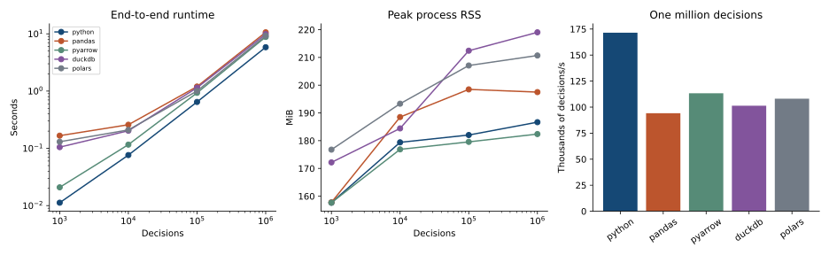
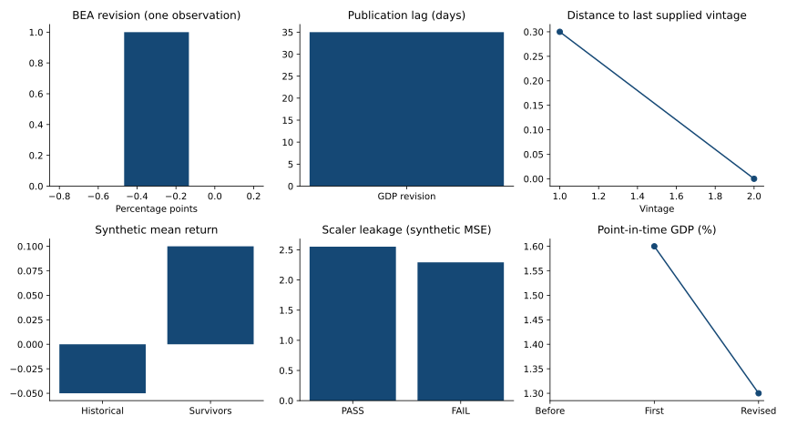
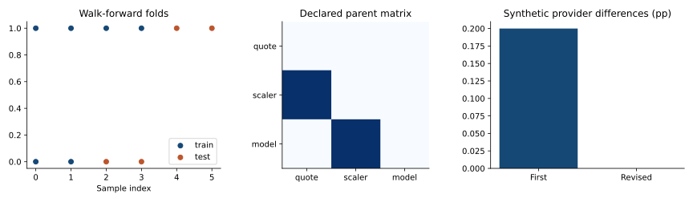

# Reproducing scientific evidence

Install the candidate, its tables, calendars and large extras, hypothesis, matplotlib, scikit-learn and curvemetric==1.5.0. From the repository root run:

    python -m benchmarks.case_studies
    for backend in python pandas pyarrow duckdb polars; do python -m benchmarks.consolidation --backend "$backend"; done
    python -m benchmarks.figures
    python -m benchmarks.scale --pandas

The CSV and Parquet fixtures encode identical decisions. Input CSV hashes identify the generated workload. Every worker runs in a fresh process. Python reads CSV with DictReader, pandas reads chunked CSV, and the other three backends stream Parquet into the same decision auditor. End-to-end throughput includes parsing, audit and oracle checking. Query and snapshot latency are averages over 1,000 calls. RSS includes native allocations and interpreter overhead. The Arrow pool metric covers the Arrow allocator only. Python allocation tracing uses a separate one-batch sample. The results are single-run observations on hosted runners, not a general ranking. The fixed 3-release dataset isolates decision scaling. Index scaling is a separate experiment.

For i from zero, the eligible value is (7i mod 3). Every fifth input with i mod 5 = 4 withholds its lineage; otherwise the claimed release is (11i+1 mod 3). The oracle is computed directly from the generator, independently of timestamp lookup. Positive means confirmed premature use. UNKNOWN contributes to the unknown rate over all decisions and is excluded from the binary confusion matrix. At one million decisions every backend recorded TP 266667, TN 533333, FP 0, FN 0, UNKNOWN 200000 and reconstruction accuracy 1. Source-row identity and the first chronological violation are checked explicitly.

The macro study uses BEA estimates and synthetic decisions. The universe and ML studies are controlled synthetic experiments. The curve experiment runs the installed CurveMetric 1.5.0 distribution with synthetic continuously compounded USD zero-rate pillars and a five-year payment. Its price oracle is 100 exp(-5r). These experiments measure selection and look-ahead effects, not investment performance.

The second CurveMetric experiment uses official US Treasury 4-, 13- and 26-week bank discount rates from May 1 and May 2, 2024. It converts each to a discount factor using nominal tenor days (weeks × 7), D = 1 − (discount rate/100) days/360, then to a continuously compounded ACT/365 zero rate. Nominal maturities model a constant-tenor comparison, not individual CUSIP settlement. Vendor receipt is unobserved. The hypothetical operator accepts the previous date's observations at 00:05 UTC the following day. The later curve is deliberately substituted at the earlier valuation instant. [Treasury historical quotes](https://home.treasury.gov/resource-center/data-chart-center/interest-rates/TextView?field_tdr_date_value_month=202405&type=daily_treasury_bill_rates)
